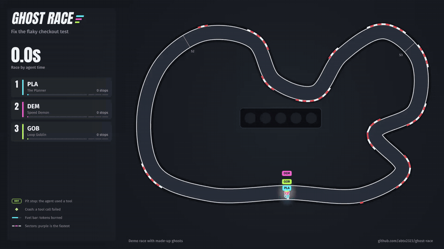

# Ghost Race

**Race your AI agents.** Load two agent session logs from the same task and watch them race it as ghosts on a track. Tool calls are pit stops, failed calls are crashes, and tokens are fuel. Export the race as an MP4 and post it.



*The demo race uses three made-up ghosts. Load your own logs to race real agents.*

**Try it:** [abtx2323.github.io/ghost-race](https://abtx2323.github.io/ghost-race/), or download this repo and open `index.html`. There's nothing to install and no build step.

## Race your own agents

1. Give two agents the same task, each in a fresh session. For example, run Claude Code and Codex on the same bug, or run the same agent with two different prompts.
2. Find the session logs:
   - **Claude Code:** `~/.claude/projects/<your-project>/<session-id>.jsonl`. List the newest with `ls -t ~/.claude/projects/*/*.jsonl | head`.
   - **Codex CLI:** `~/.codex/sessions/YYYY/MM/DD/rollout-*.jsonl`
   - **Any other agent:** write a `.ghost.json` file ([format guide](docs/FORMAT.md)).
3. Drop the files onto the page. You can race up to six ghosts.
4. Pick how to race (time, tokens or steps), add a title and click **Export clip**.

No logs handy? Drop the sample files from [`examples/`](examples) to see real Claude Code and Codex formats race.

Hidden folders tripping you up? On a Mac, press <kbd>Cmd</kbd> <kbd>Shift</kbd> <kbd>G</kbd> in the file picker and paste the path.

## What you see

| On the track | What it means |
| --- | --- |
| Ghost | One agent run. Each ghost runs one lap, from its first move to its last. |
| Pit stop label (READ, EDIT, TEST...) | The agent called a tool. Shell commands that run tests show as TEST. |
| CRASH and sparks | A tool call failed: a non-zero exit code, a failing test, an API error. |
| Dots on the racing line | Every pit stop so far, so you can see where each agent spent its moves. |
| Fuel bar | Tokens burned. |
| Timing tower | Live positions and the gap to the leader, worked out the way F1 does it: how much earlier the leader passed the same point. |
| Sectors | The lap is split into thirds. Purple marks the fastest time in each sector. |
| Race control | Story beats: where the runs first chose different tools, crashes, lead changes, the finish. |

## Three ways to race

- **Time**: active agent time. Gaps over 30 seconds (waiting for you to approve something) count as 30 seconds. You can turn that off.
- **Tokens**: total tokens. The cheapest run wins.
- **Steps**: tool calls plus replies. The most direct run wins.

## Exporting

**Export clip** records the start lights, the race and the results card in real time, about 22 seconds at 1920×1080 (wide) or 1080×1080 (square). Chrome, Edge and Safari save MP4, which X accepts. Firefox saves WebM, which you'd need to convert first. Keep the tab visible while it records.

**Save results image** saves a PNG of the results card.

## Privacy

Session logs can contain your code, file paths and prompts, so Ghost Race never uploads anything. Parsing, rendering and video encoding all happen in your browser. File names and commands are hidden on the track unless you turn on "Show file names and commands", and the race title is whatever you type.

## Supported logs

| Source | Status |
| --- | --- |
| Claude Code `.jsonl` | Supported: tool calls, failed tool results, API errors, token usage, sub-agent calls |
| Codex CLI rollout `.jsonl` | Supported: shell, apply_patch and web search calls, exit codes, token counts |
| Ghost Race `.ghost.json` | Supported. Use it for any other agent or framework. |

Ideas for adapters to add next: OpenAI Agents SDK traces, LangGraph, OpenTelemetry GenAI spans, Gemini CLI, Cursor. PRs welcome.

## Development

```
node --test "test/*.test.js"   # parser and race tests (Node 20+)
node tools/build-single.mjs    # bundle everything into dist/ghost-race.html
```

Plain JavaScript, no dependencies, no build needed to run.

| File | What it does |
| --- | --- |
| `src/parsers.js` | Turns each log format into a run: steps, pit stops, crashes, tokens |
| `src/race.js` | Race maths: progress on the lap, standings, gaps, sectors, race-control moments |
| `src/render.js` | Draws a frame on a canvas. It's a pure function of the race and playback time, so scrubbing and exports match. |
| `src/export.js` | MP4/WebM recording with MediaRecorder, PNG export |
| `src/app.js` | Page wiring |
| `src/demo.js` | The made-up demo race |

To add a log format, write a parser in `src/parsers.js` that returns events shaped like `{ t, kind: 'tool' | 'talk' | 'crash', name, cat, detail, tokens }`, add a detector in `GR.parseLog`, and add a sample to `examples/` with a test.

## License

MIT. Fonts: [Anton](https://fonts.google.com/specimen/Anton) and [Fira Sans](https://fonts.google.com/specimen/Fira+Sans) under the SIL Open Font License (see `fonts/`).
